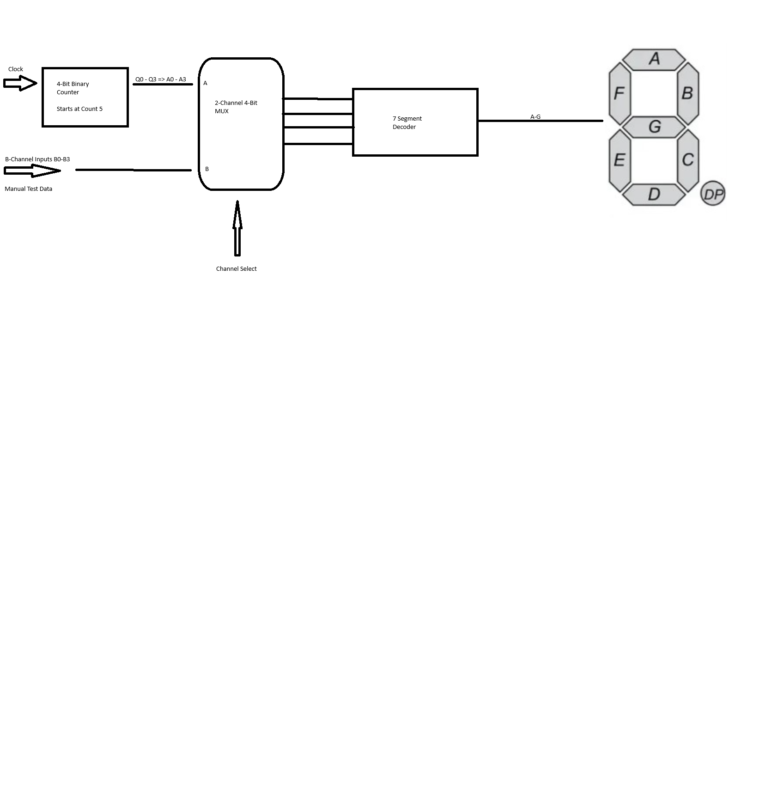
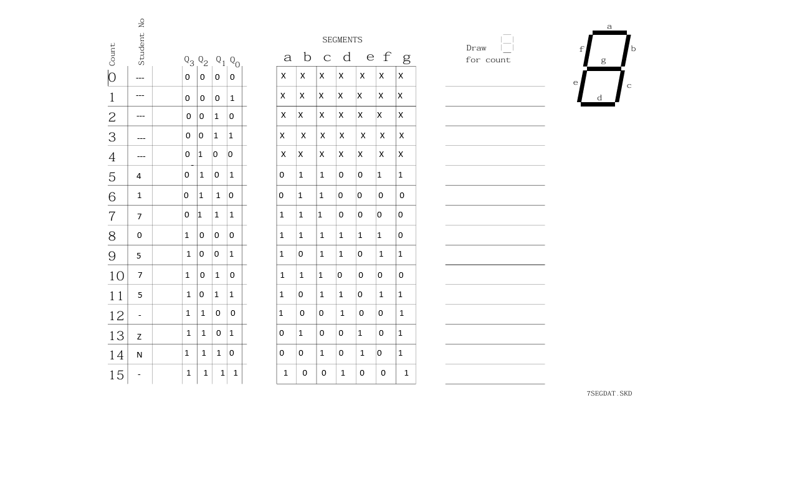
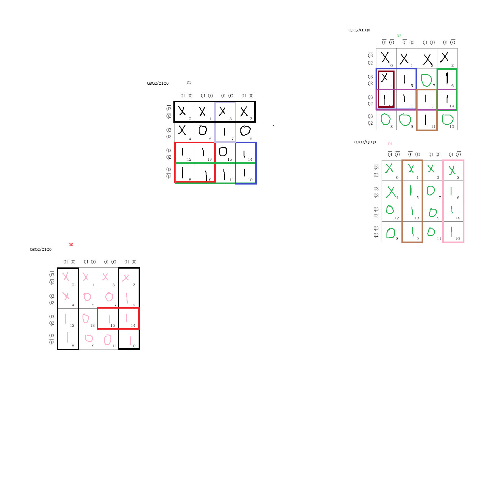

# 7-Segment Counter Display (MAX V CPLD)

A digital system that steps through a fixed message on a common-anode 7-segment display: the digits **4 1 7 0 5 7 5**, then **- Z n -**, then repeats. It's built from a 4-bit counter, a 2-channel 4-bit multiplexer and a 7-segment decoder. The counter logic and the decoder are both designed by hand with truth tables and Karnaugh maps, then written in Verilog and compiled in Quartus II for an Intel/Altera MAX V CPLD.

Built for *UEEEC0069 Troubleshoot Digital Sub-Systems* (Advanced Diploma of Electronics and Communications Engineering, RMIT, 2026).



## How it works

| Block | What it does |
|---|---|
| **Mod-11 counter** | Four D flip-flops count 5 → 15 and then wrap back to 5, giving the 11 display states. The next-state logic for each flip-flop comes from a minimised K-map. Unused states 0–4 lead back into the sequence, so the counter can't get stuck at power-up. |
| **2-channel 4-bit MUX** | `Y = S'A + SB` on each bit. Select = 0 shows the counter output; select = 1 shows four manual test inputs (B0–B3), so the decoder can be tested on its own. |
| **7-segment decoder** | Converts the 4-bit value to segments a–g. Each segment has its own minimised Boolean expression. Outputs are inverted for a common-anode display, so a segment lights when driven low. |

### Count sequence

| Count | Q3 Q2 Q1 Q0 | Shows |
|---|---|---|
| 5 | 0101 | 4 |
| 6 | 0110 | 1 |
| 7 | 0111 | 7 |
| 8 | 1000 | 0 |
| 9 | 1001 | 5 |
| 10 | 1010 | 7 |
| 11 | 1011 | 5 |
| 12 | 1100 | - |
| 13 | 1101 | Z |
| 14 | 1110 | n |
| 15 | 1111 | - |

### Design equations

Counter next state (D flip-flop inputs):

```
D3 = Q2' + Q3·Q1' + Q3·Q0' + Q3'·Q1·Q0
D2 = Q3·Q2 + Q2·Q1' + Q2·Q0' + Q3·Q1·Q0
D1 = Q1'·Q0 + Q1·Q0'
D0 = Q0' + Q3·Q2·Q1
```

Decoder (D C B A = Q3 Q2 Q1 Q0):

```
a = C' + BA + B'A'
b = D' + C'A' + CB'A
c = D' + C' + BA'
d = C'A + B'A' + DBA
e = C'B'A' + DCB'A + DCBA'
f = C'B' + C'A + D'B'
g = DC + C'A + B'A
```

| Truth table | K-maps (counter next state) |
|---|---|
|  |  |

## Files

| Path | Contents |
|---|---|
| `quartus/Project.v` | Top-level design that was compiled and tested: gate-level counter, MUX and decoder in one module |
| `quartus/Project.qpf`, `Project.qsf` | Quartus II project and pin assignments |
| `quartus/Waveform*.vwf` | Functional simulation waveforms |
| `rtl/student_display.v` | The same design split into separate modules (`counter_mod11`, `mux2ch_4bit`, `seg7_decoder`) with an active-low reset |
| `docs/` | Block diagram, truth table and K-maps |

## Hardware and tools

- **Device:** Intel/Altera MAX V CPLD, `5M80ZE64C5`
- **Software:** Quartus II 13.0 SP1 Web Edition, with functional simulation using vector waveform files
- **I/O:** manual push-button clock, channel-select switch, 4 test-input switches, common-anode 7-segment display

| Signal | Pin |
|---|---|
| `b_in[0..3]` | 18, 19, 20, 21 |
| `sel` | 24 |
| `seg_n[6..0]` (a–g) | 33, 34, 35, 36, 37, 43, 44 |

## Build it

1. Open `quartus/Project.qpf` in Quartus II 13.0 SP1 or later.
2. Run **Processing → Start Compilation**.
3. Open `Waveform.vwf` to run the functional simulation, or program the CPLD with the Programmer.

## What I learned

- Turning a required output sequence into a truth table, then minimising it with K-maps, using don't-care states.
- Designing a counter that doesn't start at zero, and making sure unused states can't lock it up.
- Using a multiplexer to add a test path, so the decoder can be checked separately from the counter.
- Writing synthesisable Verilog, assigning pins and checking the design in simulation before running it on hardware.
