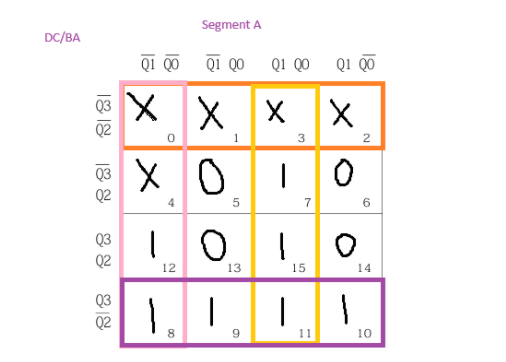
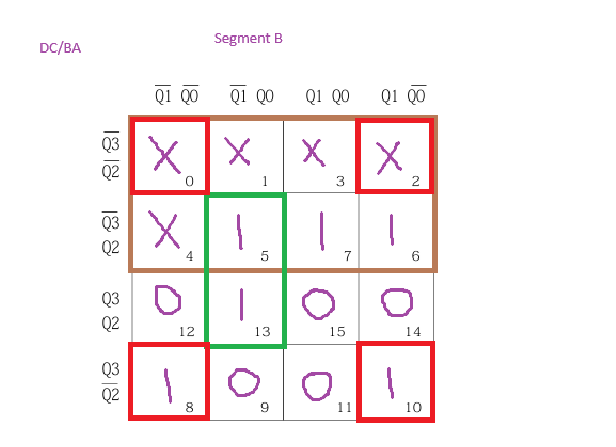
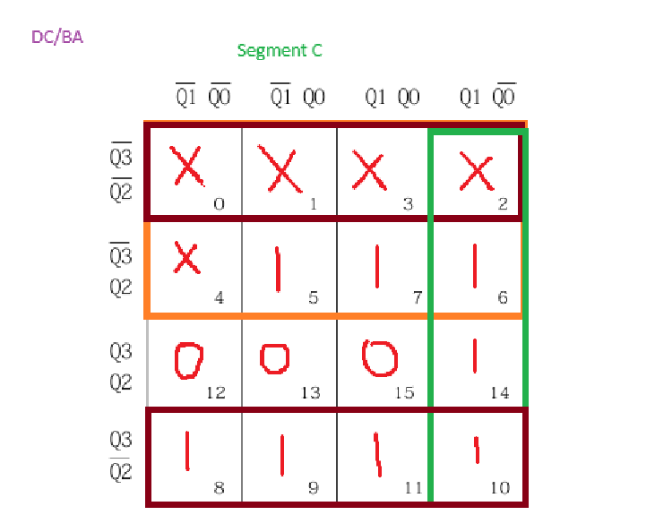
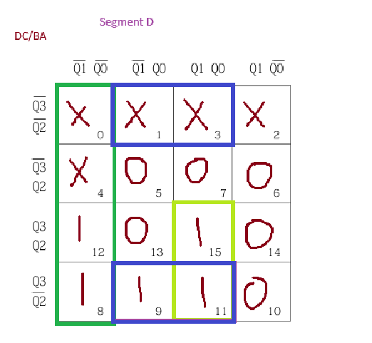
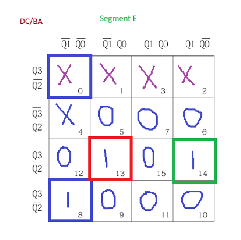
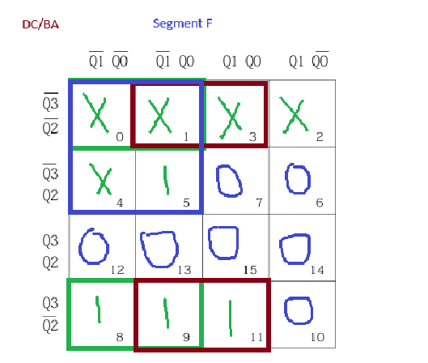
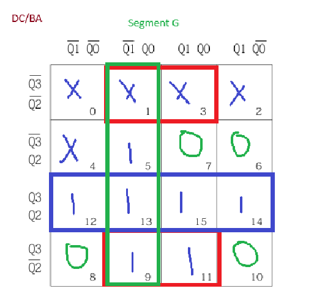

# 7-Segment Counter Display (DE2-115 FPGA)

A digital system that steps through a fixed message on a common-anode 7-segment display: the digits **4 1 7 0 5 7 5**, then **- Z n -**, then repeats. It's built from a 4-bit counter, a 2-channel 4-bit multiplexer and a 7-segment decoder. The counter logic and the decoder are both designed by hand with truth tables and Karnaugh maps, then written in Verilog in Quartus II. It was checked in simulation, then **tested on hardware on a Terasic DE2-115 FPGA board** (Intel Cyclone IV E).

Built for *UEEEC0069 Troubleshoot Digital Sub-Systems* (Advanced Diploma of Electronics and Communications Engineering, RMIT, 2026).


## How it works

| Block | What it does |
|---|---|
| **Mod-11 counter** | Four D flip-flops count 5 → 15 and then wrap back to 5, giving the 11 display states. The next-state logic for each flip-flop comes from a minimised K-map. Unused states 0–4 lead back into the sequence, so the counter can't get stuck at power-up. |
| **2-channel 4-bit MUX** | `Y = S'A + SB` on each bit. Select = 0 shows the counter output; select = 1 shows four manual test inputs (B0–B3), so the decoder can be tested on its own. |
| **7-segment decoder** | Converts the 4-bit value to segments a–g. Each segment has its own minimised Boolean expression. Outputs are inverted for a common-anode display, so a segment lights when driven low. |

### Count sequence

| Count | Q3 Q2 Q1 Q0 | Shows |
|---|---|---|
| 5 | 0101 | 4 |
| 6 | 0110 | 1 |
| 7 | 0111 | 7 |
| 8 | 1000 | 0 |
| 9 | 1001 | 5 |
| 10 | 1010 | 7 |
| 11 | 1011 | 5 |
| 12 | 1100 | - |
| 13 | 1101 | Z |
| 14 | 1110 | n |
| 15 | 1111 | - |

### Design equations

Counter next state (D flip-flop inputs):

```
D3 = Q2' + Q3·Q1' + Q3·Q0' + Q3'·Q1·Q0
D2 = Q3·Q2 + Q2·Q1' + Q2·Q0' + Q3·Q1·Q0
D1 = Q1'·Q0 + Q1·Q0'
D0 = Q0' + Q3·Q2·Q1
```

Decoder (D C B A = Q3 Q2 Q1 Q0):

```
a = C' + BA + B'A'
b = D' + C'A' + CB'A
c = D' + C' + BA'
d = C'A + B'A' + DBA
e = C'B'A' + DCB'A + DCBA'
f = C'B' + C'A + D'B'
g = DC + C'A + B'A
```

### Truth table


### Counter K-maps (D flip-flop next state)


### Segment K-maps (decoder a–g)

Counts 0–4 are never displayed, so they're treated as don't-cares (X) to get simpler expressions.

| | | |
|---|---|---|
|  |  |  |
|  |  |  |
|  | | |

## Files

| Path | Contents |
|---|---|
| `de2-115/testinginclass.v` | **The version tested on the DE2-115 board.** It maps the design to the board's push-button, switches and HEX0 display. The counter loads 5 when it reaches 15 |
| `de2-115/testinginclass.qpf`, `.qsf` | Quartus II project for the Cyclone IV E (`EP4CE115F29C7`) with the DE2-115 pin assignments |
| `de2-115/DE2-115_pin_assignments.csv` | Pin assignment table you can import into Quartus |
| `de2-115/Waveform*.vwf` | Functional simulation waveforms for the board version |
| `quartus/Project.v` | Gate-level version: counter next-state logic taken directly from the K-maps, with MUX and decoder in one module |
| `quartus/Project.qpf`, `Project.qsf` | Quartus II project for a MAX V CPLD (`5M80ZE64C5`) |
| `quartus/Waveform*.vwf` | Functional simulation waveforms |
| `rtl/student_display.v` | The same design split into separate modules (`counter_mod11`, `mux2ch_4bit`, `seg7_decoder`) with an active-low reset |
| `docs/` | Block diagram, truth table, counter K-maps, and segment K-maps (`docs/segment-kmaps/`) |

## Hardware and tools

- **Board:** Terasic DE2-115, Intel Cyclone IV E FPGA (`EP4CE115F29C7`)
- **Software:** Quartus II 13.0 SP1 Web Edition, with functional simulation using vector waveform files
- The `quartus/` version also targets an Intel/Altera MAX V CPLD (`5M80ZE64C5`)

### DE2-115 controls

| Board control | Signal | What it does |
|---|---|---|
| `KEY0` (push-button) | `clk` | Steps the counter on each press |
| `SW17` | `sel` | 0 = show the counter, 1 = show the manual test inputs |
| `SW3`–`SW0` | `b_in[3:0]` | Manual 4-bit test value for the decoder |
| `HEX0` | `HEX0[6:0]` | 7-segment display (active-low) |

The push-button clock is routed onto a global clock network, so all four flip-flops get the clock edge at the same time.

## Build it

1. Open `de2-115/testinginclass.qpf` in Quartus II 13.0 SP1 or later.
2. Run **Processing → Start Compilation**.
3. Connect the DE2-115 over USB-Blaster and program it with **Tools → Programmer**.
4. Press `KEY0` to step through the sequence, or set `SW17` and use `SW3`–`SW0` to test the decoder.

To run a simulation, open `Waveform.vwf` and run a functional simulation.

## What I learned

- Turning a required output sequence into a truth table, then minimising it with K-maps, using don't-care states.
- Designing a counter that doesn't start at zero, and making sure unused states can't lock it up.
- Using a multiplexer to add a test path, so the decoder can be checked separately from the counter.
- Writing synthesisable Verilog, assigning pins and checking the design in simulation before testing it on a real FPGA board (DE2-115).
